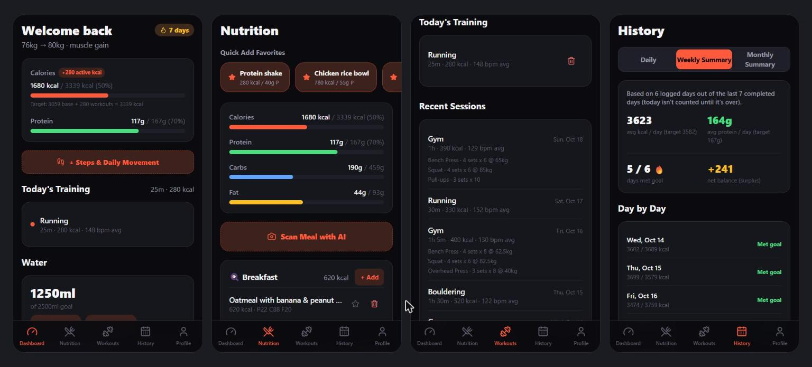
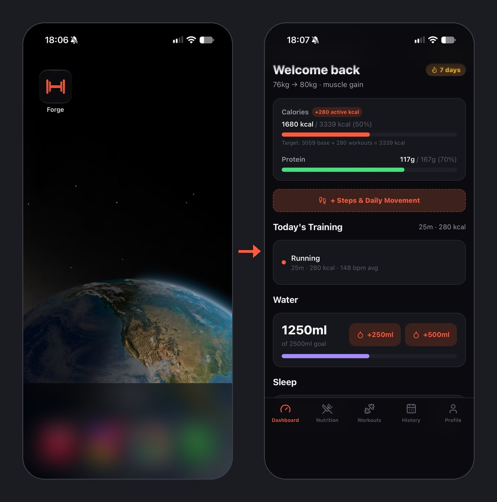
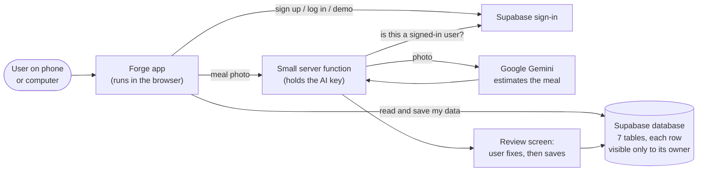

<h1 align="center">Forge</h1>

<p align="center">
  <b>A fitness &amp; nutrition tracker that puts calories, protein, workouts and sleep in one place:</b><br/>
  daily targets calculated from your body stats, a calorie budget that grows with the workouts you log,<br/>
  and meals logged from a photo with AI. Installable on an iPhone home screen, with no App Store.
</p>

<p align="center">
  <a href="https://forge-pwa-mauve.vercel.app/"><b>🔗 Live demo</b></a> ·
  
  
  
  
  
  
</p>

<p align="center">
  
  <br/><sub>Demo data (fictional). Try it: open the live demo and tap <b>"Try the demo — no sign-up"</b>. A week of sample data is created for you; log a Bench Press above 65 kg to see the progress check.</sub>
</p>

### 📱 Install it on your phone

Forge is a **web app that installs like a regular app**, straight from the browser, with no App Store.

| Device | How |
|---|---|
| **iPhone** | Open the link in **Safari** → Share → **Add to Home Screen** |
| **Android** | Open the link in **Chrome** → ⋮ menu → **Install app** (or **Add to Home screen**) |

You get a home-screen icon, and it opens full-screen with no browser bar, like any other app:

<p align="center">
  
  <br/><sub>Installed on my iPhone from Safari. Demo data.</sub>
</p>

---

## The problem

I wanted to track **protein and calories** while working toward a cut or a lean bulk, with **training and sleep in the same place** instead of spread across separate tools.

What I needed from it:

1. **Targets from my real stats**, not "2,000 kcal": a standard formula for the calories a body burns (Mifflin-St Jeor), adjusted for activity level and goal.
2. **A calorie budget that knows I trained today**: the day's target goes up by the calories actually burned.
3. **Logging fast enough to keep doing it**: favorites, adding several items at once, and a photo scan with AI.

## What it does

- **Calculated daily targets**: calories burned at rest → plus daily activity → plus or minus for the goal (gain / lose), and protein from body weight. Shown as a recommendation the user can edit
- **Workout-aware calorie budget**: `base target + workouts + daily movement = today's target`, with the breakdown shown on the dashboard
- **AI meal scan**: snap a photo, Gemini estimates calories, protein, carbs and fat, and you **review and edit** before anything is saved
- **Progress check on lifts**: your recent sessions are shown before you train, and after saving, each exercise is compared to the last time you did it ("65 kg → 70 kg ↑")
- **Sleep**: stage breakdown like Apple Health (Awake / REM / Core / Deep), entered as a duration or bedtime → wake time
- **History**: daily view, weekly and monthly summaries of completed days, days within 10% of target, logging streak, **CSV export**
- **Quality of life**: favorites for one-tap logging, water tracking, undo after delete, password reset
- **Try it without signing up**: a demo account with a week of fictional data, kept apart from real users by the database itself

## Architecture

The app runs in the browser and talks **directly to Supabase**, a hosted database with sign-in built in. There is no server of my own. Instead, **rules inside the database** decide who can read or write each row (see [`supabase/schema.sql`](supabase/schema.sql)). The one thing that can't sit in the browser, the Gemini AI key, lives in a single small function on Vercel.



## Key engineering decisions

| Decision | Why |
|---|---|
| **Web app instead of a native iOS app** | The first version was a native iPhone app. Installing it on a phone (and reading Apple Health data) needs the paid Apple Developer Program ($99/year). A web app installs from Safari's "Add to Home Screen" for free and opens full-screen like a native app. The trade-off: no Apple Health, so activity calories are entered by hand. |
| **Supabase with database rules instead of my own server** | Database, sign-in and access in one hosted service. The rule "a user only sees rows with their own user id" (`auth.uid() = user_id`) is on every table **inside the database**, so it holds even if someone skips the app and sends requests to the database directly. That removed a whole server I'd otherwise have to build and secure. |
| **The AI key only on the server** | Any setting whose name starts with `VITE_` ends up inside the code that every visitor downloads. So the key moved into a server function that first checks the caller is signed in, and only signed-in users can use the AI quota. |
| **The user reviews every AI estimate** | A photo can't show the oil in a pan or the exact size of a portion. The scan fills in a form; nothing is logged until the user confirms or corrects it. |
| **Demo with no sign-up, plus a week of sample data** | Recruiters don't sign up for apps. Supabase can create a guest account without email, which follows the same database rules, so the demo can't see anyone else's data. An empty dashboard shows nothing, so a fictional week is added on first entry. |
| **A failed load is never shown as "empty"** | "Nothing logged yet" after a network error looks like lost data, and a failed profile load used to look like a new user. Errors now get their own message with a Retry button. |

## Challenges & how I solved them

**1. The AI key was readable by anyone**
- *Symptom:* meal scanning worked, but the Gemini key was stored as `VITE_GEMINI_API_KEY`.
- *Diagnosis:* every `VITE_` setting is copied into the code that each visitor's browser downloads, so anyone could open the browser's developer tools and copy the key.
- *Fix:* moved the AI call into a server function (`api/scan-meal.ts`) that checks the user is signed in before calling Gemini, **replaced the key with a new one**, and confirmed on the live site that the key no longer appears in the downloaded code and that the function refuses requests without a login. Photos are made smaller in the browser first, because the function accepts up to 4.5 MB.

**2. "It works" isn't the same as "it fails safely"**
- *Symptom:* a test with the internet cut off: the nutrition screen said "Nothing logged yet", the weekly summary stayed on "Loading…" forever, and a failed profile load sent a returning user to the setup screen, where saving would have **overwritten their real profile**.
- *Diagnosis:* every failed load was only written to a hidden log that nobody sees on a phone, and the screen fell back to looking empty.
- *Fix:* "empty" and "failed to load" are now separate, every screen shows an error message with Retry, and a failed profile load is no longer treated as "new user". The same round of testing found a negative workout (−500 kcal) that silently lowered the day's target, a carbs target calculated as if all calories came from carbs, and weekly averages that counted today's half-finished day. All fixed.

**3. The database and the code disagreed**
- *Symptom:* saving a profile or a favorite meal failed with unclear errors.
- *Diagnosis:* the live database had changed since the code was written (some columns were renamed or changed meaning). Instead of guessing, I had the actual columns and access rules read straight from the live database.
- *Fix:* updated the code to match the real database. Lesson: when the database is the source of truth, check it first.

## Results

- **Live and installable** at the link above, updated automatically on every push to GitHub.
- I used it for my own nutrition and training for about two weeks, then stopped once I no longer had a cut or bulk goal to track. The logging habit was tied to the goal, not to the app.
- **Security checked on the live database, not assumed:** signed in as a demo user, reading other users' data returns nothing on all 7 tables, and saving data under another user's id is refused.
- **The security rules are tested automatically:** [`supabase/schema.sql`](supabase/schema.sql) is the full database structure, copied from the live project. `npm run test:rls` builds a temporary copy of the database on the computer and runs 12 checks as two different users (no reading, changing or deleting the other user's data; one sleep log per night; deleting a workout deletes its sets). To prove the checks really catch problems, the rules were removed from one table: 6 checks failed.
- **The demo stays up:** the free Supabase plan pauses a database after a week with no use, which took the demo down once. A scheduled GitHub job now reads from it every 3 days ([`keep-database-awake.yml`](.github/workflows/keep-database-awake.yml)).

## How I built it

I built Forge with an **AI-assisted workflow: Claude wrote the code**, and my part was:

- **Defined the product**: what to track, the target formula, how the calorie budget should react to workouts, what the dashboard shows first
- **Made the main decisions**: dropping the native iPhone app for a web app after hitting the $99/year wall, Supabase with database rules instead of my own server, the AI key on the server only
- **Tested on my own iPhone, with my own data**, and asked for a round of testing focused on failures (no internet, negative values, small screens, a demo user trying to read other users' data), then checked the results
- **Replaced the exposed AI key myself** once it was found in the downloaded code

## Limitations & next steps

- **No automatic activity data.** Without Apple Health (native apps only), calories from a watch are typed in by hand.
- **AI estimates are estimates.** Portion size and hidden fats are hard to see in a photo; that's why every scan goes through a review step.
- **Demo users can use the AI scan.** It's limited by Gemini's free quota; a per-user daily limit is the next step if it gets abused.
- **A few old, unused columns remain** in the database (e.g. `profiles.user_id`, `sleep_logs.sleep_hours`) from earlier designs; they're marked in `schema.sql`. Next: remove them.
- **Only the database rules have automated tests.** The target and budget math (`macroCalculator.ts`) is next, then running all tests automatically on every push.

## Tech stack

| Layer | Technology |
|---|---|
| App | React 19, TypeScript, Vite, Tailwind CSS v4, lucide-react |
| Install on phone | `vite-plugin-pwa` |
| Data & sign-in | Supabase: Postgres database, row rules, sign-in (email/password, password reset, guest demo) |
| AI | Google Gemini, through a Vercel server function |
| Hosting | Vercel, updates automatically from GitHub |

## Run locally

```bash
git clone https://github.com/guyavron/forge-pwa.git
cd forge-pwa
npm install
cp .env.example .env     # add your Supabase URL + publishable key, and a Gemini key
npm run dev              # app only; use `npx vercel dev` to also run the /api function
npm run test:rls         # check the database security rules (no Supabase account needed)
```

You'll need your own Supabase project: open **SQL Editor**, paste [`supabase/schema.sql`](supabase/schema.sql) and run it. It creates all 7 tables and their security rules. To use the demo button, also enable **anonymous sign-ins** in your project's Auth settings.

## License

[MIT](LICENSE)

---

<p align="center"><i>Built by <a href="https://github.com/guyavron">Guy Avron</a> · Industrial Engineering & Management, Ben-Gurion University</i></p>
