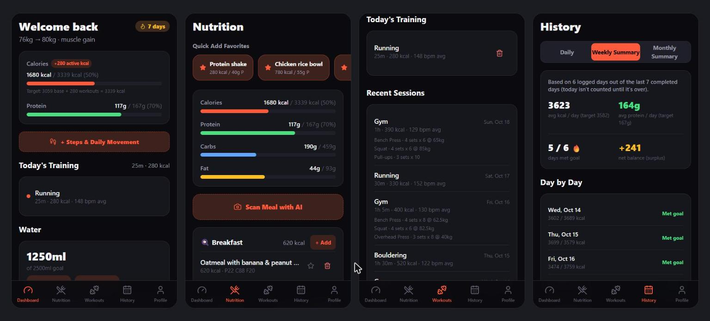
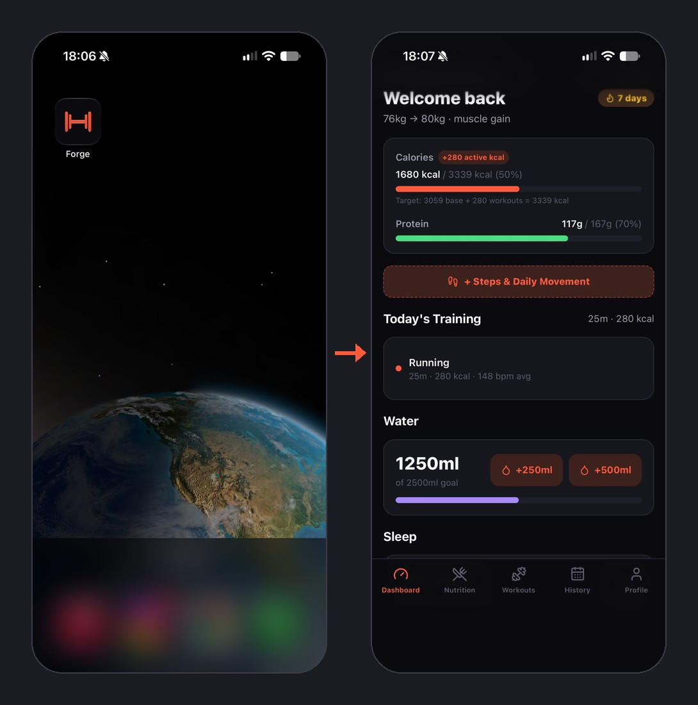
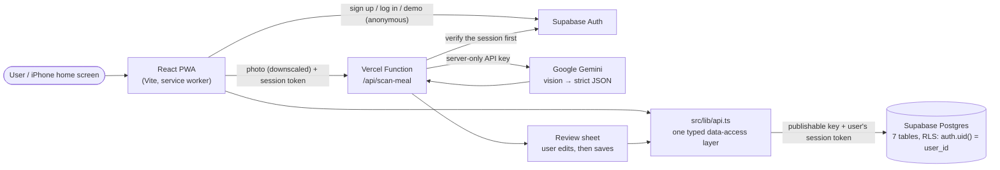

<h1 align="center">Forge</h1>

<p align="center">
  <b>A fitness &amp; nutrition tracker that puts calories, protein, workouts and sleep in one place:</b><br/>
  daily targets calculated from your body stats, a calorie budget that grows with the workouts you log,<br/>
  and meals logged from a photo with AI. Installable on an iPhone home screen, with no App Store.
</p>

<p align="center">
  <a href="https://forge-pwa-mauve.vercel.app/"><b>🔗 Live demo</b></a> ·
  
  
  
  
  
  
</p>

<p align="center">
  
  <br/><sub>Demo data (fictional). Try it: open the live demo and tap <b>"Try the demo — no sign-up"</b>. A week of sample data is created for you; log a Bench Press above 65 kg to see the progress check.</sub>
</p>

### 📱 Install it on your phone

Forge is a **Progressive Web App**: it installs from the browser like a native app, with no App Store.

| Device | How |
|---|---|
| **iPhone** | Open the link in **Safari** → Share → **Add to Home Screen** |
| **Android** | Open the link in **Chrome** → ⋮ menu → **Install app** (or **Add to Home screen**) |

You get a home-screen icon, and it opens full-screen with no browser bar, like any other app:

<p align="center">
  
  <br/><sub>Installed on my iPhone from Safari. Demo data.</sub>
</p>

---

## The problem

I wanted to track **protein and calories** while working toward a cut or a lean bulk, with **training and sleep in the same place** instead of spread across separate tools.

What I needed from it:

1. **Targets from my real stats**, not "2,000 kcal": a standard metabolic formula (Mifflin-St Jeor) adjusted for activity level and goal.
2. **A calorie budget that knows I trained today**: the day's target goes up by the calories actually burned.
3. **Logging fast enough to keep doing it**: favorites, multi-item quick add, and a photo scan with AI.

## What it does

- **Calculated daily targets**: BMR → TDEE → goal adjustment (surplus / deficit), protein from body weight. Shown as an editable recommendation, not a black box
- **Workout-aware calorie budget**: `base target + workouts + daily movement = today's target`, with the breakdown shown on the dashboard
- **AI meal scan**: snap a photo, Gemini estimates calories and macros, and you **review and edit** before anything is saved
- **Progressive overload**: recent sessions with sets and weights are shown before you train, and after saving, each exercise is compared to the last time you did it ("65 kg → 70 kg ↑")
- **Sleep**: Apple Health-style stage breakdown (Awake / REM / Core / Deep), entered as a duration or bedtime → wake time
- **History**: daily view, weekly and monthly summaries of completed days, days within ±10% of target, logging streak, **CSV export**
- **Quality of life**: favorites for one-tap logging, water tracking, undo after delete, password reset
- **Try it without signing up**: a demo account with a week of fictional data, isolated from real users by the database itself

## Architecture

A React single-page app talks **directly to Supabase** (Postgres + Auth). There is no custom backend server; **Row-Level Security policies in the database** decide who can read or write each row. The one thing that can't run in the browser, the Gemini API key, lives in a single **Vercel serverless function**.



## Key engineering decisions

| Decision | Why |
|---|---|
| **PWA instead of a native iOS app** | The first version was a native Expo app. Installing it on a phone (and using HealthKit) needs the paid Apple Developer Program ($99/year). A PWA installs from Safari's "Add to Home Screen" for free and launches full-screen like a native app. The trade-off: no HealthKit, so activity calories are entered by hand. |
| **Supabase + Row-Level Security instead of a custom backend** | Postgres, auth and an API in one managed service. Authorization lives in the database (`auth.uid() = user_id` on every table), so it holds even if someone bypasses the app and calls the API directly. That removed a whole server layer I'd otherwise have to write and secure. |
| **The AI key only on the server** | Anything in a `VITE_` variable is bundled into the JavaScript that every visitor downloads. The key moved into a serverless function that first checks the caller has a valid Supabase session, so only signed-in users can spend the AI quota. |
| **The user reviews every AI estimate** | A photo can't show the oil in a pan or the size of a portion precisely. The scan fills in a form; nothing is logged until the user confirms or corrects it. |
| **Demo through anonymous sign-in, plus a week of seeded data** | Recruiters don't sign up for apps. An anonymous Supabase user is a real account under the same RLS rules, so the demo can't see anyone else's data. An empty dashboard shows nothing, so a fictional week is seeded on first entry. |
| **A failed load is never shown as "empty"** | "Nothing logged yet" after a network error looks like lost data, and a failed profile load used to look like a new user. Errors now get their own state with a Retry button. |

## Challenges & how I solved them

**1. The AI key was readable by anyone**
- *Symptom:* meal scanning worked, but the Gemini key was set as `VITE_GEMINI_API_KEY`.
- *Diagnosis:* Vite inlines every `VITE_` variable into the JavaScript bundle that every visitor downloads, so anyone could open DevTools and copy the key.
- *Fix:* moved the call into a Vercel function (`api/scan-meal.ts`) that verifies the Supabase session before calling Gemini, **rotated the key**, and confirmed on the live site that the key no longer appears in the bundle and that the endpoint returns 401 without a login. Photos are downscaled in the browser first, to stay under the function's 4.5 MB request limit.

**2. "It works" isn't the same as "it fails safely"**
- *Symptom:* a QA pass with the network cut off: the nutrition screen said "Nothing logged yet", the weekly summary stayed on "Loading…" forever, and a failed profile load sent a returning user to onboarding, where saving would have **overwritten their real profile**.
- *Diagnosis:* every load ended in `.catch(console.error)`. The error went to a console nobody sees on a phone, and the UI fell back to its empty state.
- *Fix:* separate states for *empty* and *failed*, a shared `LoadError` component with Retry on every screen, and `"error"` kept apart from "no profile yet". The same pass found a negative workout (−500 kcal) that silently lowered the day's target, a carbs target computed as if 100% of calories came from carbs, and weekly averages that counted today's half-finished day; all fixed.

**3. The database and the code disagreed**
- *Symptom:* saving a profile or a favorite meal failed with opaque 400/403 errors.
- *Diagnosis:* the live schema had changed since the code was written (`profiles.id` became the auth user id; `favorite_meals` columns were renamed). Instead of guessing, I queried `information_schema.columns` and `pg_policies` on the live database.
- *Fix:* aligned the TypeScript types and `api.ts` to the actual schema. Lesson: when the database is the source of truth, read it first.

## Results

- **Live and installable** at the link above, deployed automatically from `main` on every push.
- I used it for my own nutrition and training for about two weeks, then stopped once I no longer had a cut or bulk goal to track. The logging habit was tied to the goal, not to the app.
- **Security verified on the live database, not assumed:** as a demo user, reading other users' rows returns nothing on all 7 tables, and inserting rows under another user's id is rejected (`403`, RLS).
- ~3,900 lines of TypeScript, `tsc` + production build pass with zero errors.

## How I built it

I built Forge with an **AI-assisted workflow, using Claude as the implementation partner**. My part:

- **Defined the product**: what to track, the target formula, how the calorie budget should react to workouts, what the dashboard shows first
- **Made the architecture calls**: dropping native iOS for a PWA after hitting the $99/year wall, Supabase with RLS instead of a custom server, AI on the server only
- **Tested on my own iPhone, with my own data**, and ran a failure-focused QA pass (no network, negative values, narrow screens, a demo user trying to read other users' data)
- **Kept security in my hands**: the key rotation, Supabase Auth settings (site URL, anonymous sign-ins) and the deployment

## Limitations & next steps

- **No automatic activity data.** Without HealthKit (native only), calories from a watch are typed in by hand.
- **AI estimates are estimates.** Portion size and hidden fats are hard to see in a photo; that's why every scan goes through a review step.
- **Demo users can use the AI scan.** It's limited by the Gemini free-tier quota; a per-user rate limit is the next step if it gets abused.
- **The database schema isn't in the repo yet.** Next: export the tables and RLS policies as a SQL migration so the project can be recreated from scratch.
- **No automated tests.** The macro and budget math (`macroCalculator.ts`) is the first candidate for unit tests.

## Tech stack

| Layer | Technology |
|---|---|
| Frontend | React 19, TypeScript, Vite, Tailwind CSS v4, lucide-react |
| App install | `vite-plugin-pwa` (Workbox service worker + web manifest) |
| Data & auth | Supabase: Postgres, Row-Level Security, Auth (email/password, password reset, anonymous demo) |
| AI | Google Gemini vision, through a Vercel serverless function |
| Hosting | Vercel, auto-deploy from GitHub |

## Run locally

```bash
git clone https://github.com/guyavron/forge-pwa.git
cd forge-pwa
npm install
cp .env.example .env     # add your Supabase URL + publishable key, and a Gemini key
npm run dev              # app only; use `npx vercel dev` to also run the /api function
```

You'll need your own Supabase project with the tables from `src/types/database.ts` and RLS enabled (see *Limitations*).

## License

[MIT](LICENSE)

---

<p align="center"><i>Built by <a href="https://github.com/guyavron">Guy Avron</a> · Industrial Engineering & Management, Ben-Gurion University</i></p>
